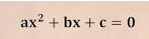
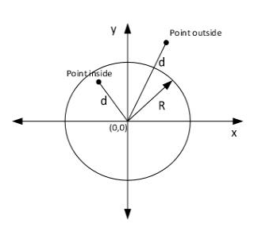
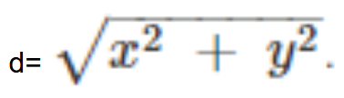

# Expressions booleanes i condicionals

## Expressions booleanes

### 📝 Exercici: escriu l'expressió booleana
{: .exercici}

Donat el codi següent:

```csharp
char c = Convert.ToChar(Console.ReadLine()!);
double angle = Convert.ToDouble(Console.ReadLine());
bool b;
```

Escriu l'expressió booleana que permet valorar cada cas:

1. `c` és una lletra minúscula
2. `c` és una lletra
3. `c` no és una lletra
4. `c` és una vocal
5. `c` és una consonant
6. `c` és un dígit numèric
7. `angle` és un angle obtús (més gran de 90 i menys de 180)
8. `b` és cert
9. `b` és fals

{: .solucio}
```csharp
// 1. c és una lletra minúscula
c >= 'a' && c <= 'z'

// 2. c és una lletra
(c >= 'a' && c <= 'z') || (c >= 'A' && c <= 'Z')

// 3. c no és una lletra
!((c >= 'a' && c <= 'z') || (c >= 'A' && c <= 'Z'))

// 4. c és una vocal
c == 'a' || c == 'e' || c == 'i' || c == 'o' || c == 'u' ||
c == 'A' || c == 'E' || c == 'I' || c == 'O' || c == 'U'

// 5. c és una consonant (és una lletra i no és una vocal)
((c >= 'a' && c <= 'z') || (c >= 'A' && c <= 'Z')) &&
!(c == 'a' || c == 'e' || c == 'i' || c == 'o' || c == 'u' ||
  c == 'A' || c == 'E' || c == 'I' || c == 'O' || c == 'U')

// 6. c és un dígit numèric
c >= '0' && c <= '9'

// 7. angle és un angle obtús
angle > 90 && angle < 180

// 8. b és cert
b == true 

// 9. b és fals
b == false
```

<!-- /exercici -->


### 📝 Exercici: Lleis de De Morgan
{: .exercici}

Escriu el negat de les expressions booleanes següents, **sense fer servir `!` davant de parèntesis**:

1. `!b && c != '.'`
2. `x < 3 || y == 0 && z == 0`
3. `('a' < x) && (x <= 'z')`
4. `(x != 'a') && (x != 'e') && (x != 'i') && (x != 'o') && (x != 'u')`

{: .solucio}
```csharp
// 1.
!(!b && c != '.')
b || c == '.'

// 2.
!(x < 3 || (y == 0 && z == 0))
!(x < 3) && !(y == 0 && z == 0)
(x >= 3) && (y != 0 || z != 0)
x >= 3 && (y != 0 || z != 0)

// 3.
!(('a' < x) && (x <= 'z'))
!('a' < x) || !(x <= 'z')
x <= 'a' || x > 'z'

// 4. 
!((x != 'a') && (x != 'e') && (x != 'i') && (x != 'o') && (x != 'u'))
!(x != 'a') || !(x != 'e') || !(x != 'i') || !(x != 'o') || !(x != 'u')
x == 'a' || x == 'e' || x == 'i' || x == 'o' || x == 'u'
```


<!-- /exercici -->


### 📝 Exercici: equació de segon grau
{: .exercici}

Escriu una expressió booleana que valori `true` si les variables reals `a`, `b` i `c` satisfan l'equació de segon grau per a un valor concret de `x`.



{: .solucio}
```csharp
a * x * x + b * x + c == 0
```


<!-- /exercici -->


### 📝 Exercici: punt dins d'un 
{: .exercici}

Escriu una expressió booleana que valori `true` si un punt amb coordenades reals `(x, y)` es troba dins d'un cercle de radi real `r` centrat a l'origen `(0, 0)`.



Per calcular la distància `d` d'un punt a l'origen de coordenades, fes servir la fórmula:



{: .solucio}
> El punt és dins del cercle si la seva distància a l'origen és **menor o igual** que el radi.

```csharp
Math.Sqrt(x * x + y * y) <= r
```


<!-- /exercici -->


### 📝 Exercici: venedors
{: .exercici}

Tenim 3 variables (`sellsMichael`, `sellsPeter` i `sellsJohn`) que contenen la quantitat d'euros que ha venut cada venedor durant un any.

Escriu expressions booleanes que valorin `true` si es compleixen les condicions següents:

1. Michael és el millor venedor.
2. Cap venedor ha venut menys de 20.000 €.
3. Algun venedor ha venut més de 5.000 €.
4. La mitjana de les 3 quantitats és superior a 8.000 €.
5. La mitjana de les 3 quantitats és superior a 8.000 € o hi ha algun venedor que ha venut menys de 4.000 €.
6. Peter no és el millor venedor.

{: .solucio}
```csharp

// 1. Michael és el millor venedor
sellsMichael > sellsPeter && sellsMichael > sellsJohn

// 2. Cap venedor ha venut menys de 20.000 €
sellsMichael >= 20000 && sellsPeter >= 20000 && sellsJohn >= 20000

// 3. Algun venedor ha venut més de 5.000 €
sellsMichael > 5000 || sellsPeter > 5000 || sellsJohn > 5000

// 4. La mitjana és superior a 8.000 €
(sellsMichael + sellsPeter + sellsJohn) / 3.0 > 8000

// 5. La mitjana és superior a 8.000 € o algun ha venut menys de 4.000 €
(sellsMichael + sellsPeter + sellsJohn) / 3.0 > 8000 ||
sellsMichael < 4000 || sellsPeter < 4000 || sellsJohn < 4000

// 6. Peter no és el millor venedor
!(sellsPeter > sellsMichael && sellsPeter > sellsJohn)
// o, aplicant De Morgan:
sellsPeter <= sellsMichael || sellsPeter <= sellsJohn
```


<!-- /exercici -->


## Estructures condicionals simples

### 📝 Exercici: funció ValorAbsolut
{: .exercici}

Implementa una funció `ValorAbsolut` que rebi un nombre real i retorni el seu valor absolut.

```csharp
public static void Main(string[] args)
{
    Console.WriteLine(ValorAbsolut(-8));
    Console.WriteLine(ValorAbsolut(3));
    Console.WriteLine(ValorAbsolut(0));
}
```

```console
    > 8
    > 3
    > 0
```

{: .solucio}
```csharp
public static double ValorAbsolut(double x)
{
    double resultat = x;

    if (x < 0)
    {
        resultat = -x;
    }

    return resultat;
}
```

<!-- /exercici -->


### 📝 Exercici: funció 
{: .exercici}

El volum d'un altaveu va de 0 a 100. Implementa una funció `LimitarVolum` que rebi un volum i el retorni tal com és, però si passa de 100, ha de retornar 100.

```csharp
public static void Main(string[] args)
{
    Console.WriteLine($"Volum: {LimitarVolum(40)}");
    Console.WriteLine($"Volum: {LimitarVolum(150)}");
}
```

```console
> Volum: 40
> Volum: 100
```

{: .solucio}
```csharp
public static int LimitarVolum(int volum)
{
    int resultat;
    resultat = volum;
    if (volum > 100)
    {
        resultat = 100;
    }
    return resultat;
}
```


<!-- /exercici -->


### 📝 Exercici: funció CalcularPreuFinal
{: .exercici}

Una botiga en línia cobra **5 €** d'enviament, però l'enviament és gratuït si la compra és de **50 € o més**. Implementa una funció `CalcularPreuFinal` que rebi l'import de la compra i retorni el total a pagar.

```csharp
public static void Main(string[] args)
{
    Console.WriteLine($"Total: {CalcularPreuFinal(30)} €");
    Console.WriteLine($"Total: {CalcularPreuFinal(60)} €");
}
```

```console
> Total: 35 €
> Total: 60 €
```

{: .solucio}
```csharp
public static double CalcularPreuFinal(double import)
{
    double total;
    total = import;
    if (import < 50)
    {
        total = total + 5;
    }
    return total;
}
```

<!-- /exercici -->


### 📝 Exercici: funció EsMajorEdat
{: .exercici}

Implementa una funció `EsMajorEdat` que rebi una edat i retorni `true` si és major d'edat (18 anys o més) i `false` en cas contrari.

```csharp
public static void Main(string[] args)
{
    Console.WriteLine(EsMajorEdat(17));
    Console.WriteLine(EsMajorEdat(18));
}
```

```console
> False
> True
```

{: .solucio}

```csharp
public static bool EsMajorEdat(int edat)
{
    bool resultat;
    if (edat >= 18)
    {
        resultat = true;
    }
    else
    {
        resultat = false;
    }
    return resultat;
}
```


<!-- /exercici -->


### 📝 Exercici: funció Qualificar
{: .exercici}

Implementa una funció `Qualificar` que rebi una nota i retorni `"Assolit"` si és 5 o més, i `"No assolit"` en cas contrari.

```csharp
public static void Main(string[] args)
{
    Console.WriteLine($"Un 7: {Qualificar(7)}");
    Console.WriteLine($"Un 3: {Qualificar(3)}");
}
```

```console
> Un 7: Assolit
> Un 3: No assolit
```

{: .solucio}

```csharp
public static string Qualificar(double nota)
{
    string resultat;
    if (nota >= 5)
    {
        resultat = "Assolit";
    }
    else
    {
        resultat = "No assolit";
    }
    return resultat;
}
```


<!-- /exercici -->


## Estructures condicionals múltiples

### 📝 Exercici: funció Signe
{: .exercici}

Implementa una funció `Signe` que rebi un nombre enter i retorni:

- `"positiu"` si és més gran que zero.
- `"negatiu"` si és més petit que zero.
- `"zero"` si és igual a zero.

```csharp
public static void Main(string[] args)
{
  Console.WriteLine(Signe(5));
  Console.WriteLine(Signe(-3));
  Console.WriteLine(Signe(0));
}
```

```console
    > positiu
    > negatiu
    > zero
```

{: .solucio}

```csharp
public static string Signe(int num)
{
    string resultat;

    if (num > 0)
    {
        resultat = "positiu";
    }
    else if (num < 0)
    {
        resultat = "negatiu";
    }
    else
    {
        resultat = "zero";
    }

    return resultat;
}
```

<!-- /exercici -->


### 📝 Exercici: funció ObtenirQualificacio
{: .exercici}

Implementa una funció `ObtenirQualificacio` que rebi una nota entre 0 i 10 i retorni la qualificació en format text:

| Nota            | Qualificació      |
|-----------------|-------------------|
| [0, 5)          | No assolit        |
| [5, 7)          | Aprovat           |
| [7, 9)          | Notable           |
| [9, 10)         | Excel·lent        |
| 10              | Matrícula d'honor |
| < 0 o > 10      | Nota no vàlida    |

```csharp
public static void Main(string[] args)
{
    Console.WriteLine(ObtenirQualificacio(4.5));
    Console.WriteLine(ObtenirQualificacio(7.2));
    Console.WriteLine(ObtenirQualificacio(10));
    Console.WriteLine(ObtenirQualificacio(12));
}
```

```console
> No assolit
> Notable
> Matrícula d'honor
> Nota no vàlida
```

{: .solucio}

```csharp
public static string ObtenirQualificacio(double nota)
{
    string resultat;
    if (nota < 0 || nota > 10)
    {
        resultat = "Nota no vàlida";
    }
    else if (nota < 5)
    {
        resultat = "No assolit";
    }
    else if (nota < 7)
    {
        resultat = "Aprovat";
    }
    else if (nota < 9)
    {
        resultat = "Notable";
    }
    else if (nota < 10)
    {
        resultat = "Excel·lent";
    }
    else
    {
        resultat = "Matrícula d'honor";
    }
    return resultat;
}
```


<!-- /exercici -->


### 📝 Exercici: funció PreuEntrada
{: .exercici}

Implementa una funció `PreuEntrada` que rebi l'edat d'una persona i retorni el preu de l'entrada de cinema:

| Edat              | Preu   |
|-------------------|--------|
| 4 anys o menys    | Gratis |
| de 5 a 11 anys    | 5 €    |
| 65 anys o més     | 6 €    |
| la resta          | 8 €    |

```csharp
public static void Main(string[] args)
{
    Console.WriteLine($"3 anys: {PreuEntrada(3)} €");
    Console.WriteLine($"9 anys: {PreuEntrada(9)} €");
    Console.WriteLine($"30 anys: {PreuEntrada(30)} €");
    Console.WriteLine($"70 anys: {PreuEntrada(70)} €");
}
```

```console
> 3 anys: 0 €
> 9 anys: 5 €
> 30 anys: 8 €
> 70 anys: 6 €
```

<details markdown="1">
<summary markdown="span">Mostra la solució</summary>

```csharp
public static int PreuEntrada(int edat)
{
    int preu;
    if (edat <= 4)
    {
        preu = 0;
    }
    else if (edat < 12)
    {
        preu = 5;
    }
    else if (edat >= 65)
    {
        preu = 6;
    }
    else
    {
        preu = 8;
    }
    return preu;
}
```


<!-- /exercici -->


### 📝 Exercici: funció InfoTemperatura
{: .exercici}

Implementa una funció `InfoTemperatura` que rebi una temperatura en graus (`double`) i retorni un missatge segons aquesta taula:

| Temperatura (°C) | Missatge       |
|------------------|----------------|
| < 0              | Està glaçat    |
| [0, 15)          | Fa fred        |
| [15, 25)         | S'hi està bé   |
| >= 25             | Fa calor       |

> `[0, 15)` vol dir de 0 (inclòs) fins a 15 (no inclòs).

```csharp
public static void Main(string[] args)
{
    Console.WriteLine($"-2,5 °C: {InfoTemperatura(-2.5)}");
    Console.WriteLine($"14,9 °C: {InfoTemperatura(14.9)}");
    Console.WriteLine($"15 °C: {InfoTemperatura(15)}");
    Console.WriteLine($"30 °C: {InfoTemperatura(30)}");
}
```

```console
> -2,5 °C: Està glaçat
> 14,9 °C: Fa fred
> 15 °C: S'hi està bé
> 30 °C: Fa calor
```

{: .solucio}

```csharp
public static string InfoTemperatura(double temperatura)
{
    string missatge;
    if (temperatura < 0)
    {
        missatge = "Està glaçat";
    }
    else if (temperatura < 15)
    {
        missatge = "Fa fred";
    }
    else if (temperatura < 25)
    {
        missatge = "S'hi està bé";
    }
    else
    {
        missatge = "Fa calor";
    }
    return missatge;
}
```


<!-- /exercici -->
