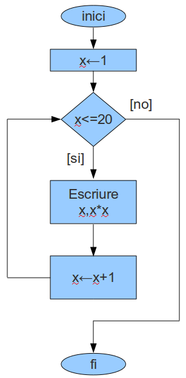
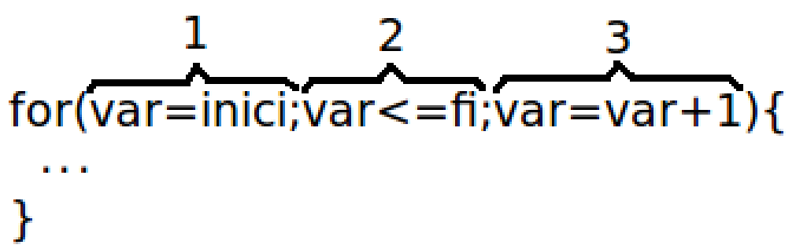

# Estructures repetitives

Fins ara, cada instrucció s'executava com a molt una vegada. Amb les **estructures repetitives**, el programa pot **repetir un bloc d'instruccions** mentre es compleixi una **condició**.

## Estructura while

El `while` comprova la condició **al principi**. Si és certa, executa el bloc i torna a comprovar la condició. Quan és falsa, surt del bucle i el programa continua.



```csharp
while (condicio)
{
    // instruccions que es repeteixen mentre la condició és certa
}
```

Un `while` sol tenir tres parts:

1. **Inicialització**: donem un valor inicial a la variable que controla el bucle (`x = 1`).
2. **Condició**: diu fins quan es repeteix (`x <= n`).
3. **Actualització**: dins el bucle, canviem la variable perquè algun dia la condició sigui falsa (`x = x + 1`).

Exemple: programa que escriu els nombres de l'1 al 5 i el seu quadrat (és el programa de l'ordinograma).

```csharp
public static void Main(string[] args)
{
    int x = 1;

    while (x <= 5)
    {
        Console.WriteLine($"{x} {x * x}");
        x = x + 1;
    }
}
```

```text
> 1 1
> 2 4
> 3 9
> 4 16
> 5 25
```

## Estructura for

El `for` és una estructura més compacte: posa les **tres parts** del bucle en una sola línia. El fem servir quan **sabem quantes voltes** ha de fer el bucle.



1. **Inicialització**: s'executa una sola vegada, al principi (`int i = 1`).
2. **Condició**: es comprova abans de cada volta (`i <= 5`).
3. **Actualització**: s'executa al final de cada volta (`i++`).

> `i++` vol dir el mateix que `i = i + 1`, i `i--` el mateix que `i = i - 1`.

Exemple: el mateix programa dels quadrats, amb `while` i amb `for`.

<div class="bucles">

<div markdown="1">

**Amb while**

```csharp
int x = 1;

while (x <= 5)
{
    Console.WriteLine($"{x} {x * x}");
    x = x + 1;
}
```

</div>

<div markdown="1">

**Amb for**

```csharp
for (int x = 1; x <= 5; x++)
{
    Console.WriteLine($"{x} {x * x}");
}
```

</div>

</div>

```text
> 1 1
> 2 4
> 3 9
> 4 16
> 5 25
```

## Exercicis while

### 📝 Exercici: quin és el resultat?

Digues què escriu cadascun d'aquests bucles. Compte, que no tots funcionen com sembla!

<style>
.bucles {
  display: grid;
  grid-template-columns: repeat(2, minmax(0, 1fr));
  gap: 1em;
}
.bucles > div {
  border: 1px solid #ddd;
  border-radius: 6px;
  padding: 0.5em 1em;
}
.bucles pre {
  min-height: 11em;
  overflow-x: auto;
}
@media (max-width: 600px) {
  .bucles { grid-template-columns: 1fr; }
}
</style>

<div class="bucles">

<div markdown="1">

**Bucle 1**

```csharp
int i = 0;

while (i < 10)
{
    Console.WriteLine($"ITERACIÓ {i}");
    i = i + 1;
}
```

<details markdown="1">
<summary markdown="span">Mostra la solució</summary>

```text
> ITERACIÓ 0
> ITERACIÓ 1
> ITERACIÓ 2
> ITERACIÓ 3
> ITERACIÓ 4
> ITERACIÓ 5
> ITERACIÓ 6
> ITERACIÓ 7
> ITERACIÓ 8
> ITERACIÓ 9
```

</details>

</div>

<div markdown="1">

**Bucle 2**

```csharp
int i = 0;

while (i < 10)
{
    Console.WriteLine($"ITERACIÓ {i}");
}

```

<details markdown="1">
<summary markdown="span">Mostra la solució</summary>

```text
> ITERACIÓ 0
> ITERACIÓ 0
> ITERACIÓ 0
> ITERACIÓ 0
> ...
```

**Bucle infinit**: falta `i = i + 1` i `i` no canvia mai.

</details>

</div>

<div markdown="1">

**Bucle 3**

```csharp
int i = 20;

while (i < 10)
{
    Console.WriteLine($"ITERACIÓ {i}");
    i = i + 1;
}
```

<details markdown="1">
<summary markdown="span">Mostra la solució</summary>

```text
 
```

No escriu res: la condició ja és falsa al principi i **no entra mai**.

</details>

</div>

<div markdown="1">

**Bucle 4**

```csharp
int i = 10;

while (i > 0)
{
    Console.WriteLine($"ITERACIÓ {i}");
    i = i - 1;
}
```

<details markdown="1">
<summary markdown="span">Mostra la solució</summary>

```text
> ITERACIÓ 10
> ITERACIÓ 9
> ITERACIÓ 8
> ITERACIÓ 7
> ITERACIÓ 6
> ITERACIÓ 5
> ITERACIÓ 4
> ITERACIÓ 3
> ITERACIÓ 2
> ITERACIÓ 1
```

La variable **baixa**: comença a 10 i resta 1 a cada volta. Fa 10 voltes, igual que el bucle 1, però en ordre invers.

</details>

</div>

</div>

### 📝 Exercici: escriure de l'1 al N

Fes un programa que, donat un nombre `N` (per exemple, 4), escrigui els nombres de l'1 al `N`.

```text
> 1 2 3 4
```

<details markdown="1">
<summary markdown="span">Mostra la solució</summary>

```csharp
public static void Main(string[] args)
{
    const int N = 4;
    int i = 1;

    while (i <= N)
    {
        Console.Write(i + " ");
        i = i + 1;
    }
}
```

</details>

### 📝 Exercici: taula de multiplicar

Fes un programa que, donat un nombre (per exemple, 7), escrigui la seva taula de multiplicar (de l'1 al 10).

```text
> 7 x 1 = 7
> 7 x 2 = 14
> ...
> 7 x 10 = 70
```

<details markdown="1">
<summary markdown="span">Mostra la solució</summary>

```csharp
public static void Main(string[] args)
{
    const int MAX = 10;
    int taula = 7;
    int i = 1;

    while (i <= MAX)
    {
        Console.WriteLine($"{taula} x {i} = {taula * i}");
        i = i + 1;
    }
}
```

</details>

### 📝 Exercici: suma de l'1 al N

Fes un programa que, donat un nombre `N` (per exemple, 4), calculi i escrigui la suma de l'1 al `N`: 1 + 2 + 3 + 4 = 10.


```text
> Suma fins a 4: 10
```

<details markdown="1">
<summary markdown="span">Mostra la solució</summary>

```csharp
public static void Main(string[] args)
{
    const int N = 4;
    int suma = 0;
    int i = 1;

    while (i <= N)
    {
        suma = suma + i;
        i = i + 1;
    }
    Console.WriteLine($"Suma fins a {n}: {suma}");
}
```

</details>

### 📝 Exercici: compte enrere

Fes un programa que faci un compte enrere del 5 a l'1 i, al final, escrigui `Enlairament!`.

```text
> 5
> 4
> 3
> 2
> 1
> Enlairament!
```

<details markdown="1">
<summary markdown="span">Mostra la solució</summary>

```csharp
public static void Main(string[] args)
{
    int compte = 5;

    while (compte > 0)
    {
        Console.WriteLine(compte);
        compte = compte - 1;
    }
    Console.WriteLine("Enlairament!");
}
```

</details>

## Exercicis for

### 📝 Exercici: quin és el resultat?

Digues què escriu cadascun d'aquests bucles.

<div class="bucles">

<div markdown="1">

**Bucle 1**

```csharp
for (int i = 0; i < 5; i++)
{
    Console.Write($"{i} ");
}
```

<details markdown="1">
<summary markdown="span">Mostra la solució</summary>

```text
> 0 1 2 3 4
```

Comença a 0 i s'atura abans del 5: **5 voltes**.

</details>

</div>

<div markdown="1">

**Bucle 2**

```csharp
for (int i = 1; i <= 10; i = i + 2)
{
    Console.Write($"{i} ");
}
```

<details markdown="1">
<summary markdown="span">Mostra la solució</summary>

```text
> 1 3 5 7 9
```

Suma **2** a cada volta.

</details>

</div>

<div markdown="1">

**Bucle 3**

```csharp
for (int i = 5; i > 0; i--)
{
    Console.Write($"{i} ");
}
```

<details markdown="1">
<summary markdown="span">Mostra la solució</summary>

```text
> 5 4 3 2 1
```

La variable **baixa** a cada volta.

</details>

</div>

<div markdown="1">

**Bucle 4**

```csharp
for (int i = 10; i < 5; i++)
{
    Console.Write($"{i} ");
}
```

<details markdown="1">
<summary markdown="span">Mostra la solució</summary>

```text
 
```

No escriu res: la condició ja és falsa al principi i **no entra mai**.

</details>

</div>

</div>

### 📝 Exercici: nombres parells

Fes un programa que escrigui els 10 primers nombres parells.

```text
> 2 4 6 8 10 12 14 16 18 20
```

<details markdown="1">
<summary markdown="span">Mostra la solució</summary>

```csharp
public static void Main(string[] args)
{
    const int N = 10;

    for (int i = 1; i <= N; i++)
    {
        Console.Write($"{2 * i} ");
    }
}
```

</details>

### 📝 Exercici: producte de l'1 al N

Fes un programa que, donat un nombre `N` (per exemple, 4), calculi el producte de l'1 al `N`: 1 · 2 · 3 · 4 = 24.

> Pista: com a la suma, però la variable `producte` ha de començar a **1**, no a 0.

```text
> Producte fins a 4: 24
```

<details markdown="1">
<summary markdown="span">Mostra la solució</summary>

```csharp
public static void Main(string[] args)
{
    const int N = 4;
    int producte = 1;

    for (int i = 1; i <= N; i++)
    {
        producte = producte * i;
    }
    Console.WriteLine($"Producte fins a {N}: {producte}");
}
```

</details>

### 📝 Exercici: rectangle d'asteriscs

Fes un programa que dibuixi un rectangle d'asteriscs de 5 d'amplada i 3 d'alçada.

> Pista: un `for` per a les files i, **a dins**, un altre `for` per escriure els asteriscs de cada fila.

```text
> *****
> *****
> *****
```

<details markdown="1">
<summary markdown="span">Mostra la solució</summary>

```csharp
public static void Main(string[] args)
{
    const char CARACTER = '*';
    const int AMPLADA = 5;
    const int ALCADA = 3;

    for (int i = 0; i < ALCADA; i++)
    {
        for (int j = 0; j < AMPLADA; j++)
        {
            Console.Write(CARACTER);
        }
        Console.WriteLine();
    }
}
```

</details>